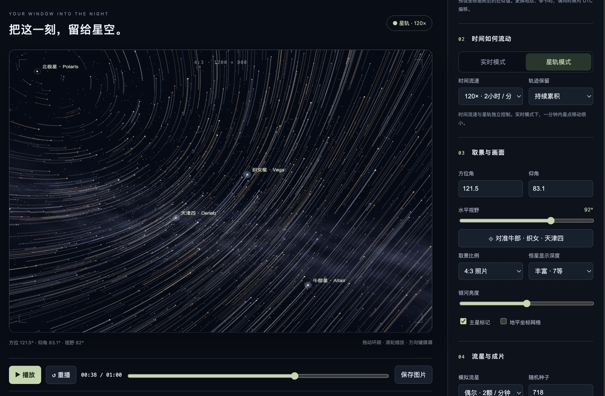

# 星野 · StarSky Studio

**从地球视角探索完整的360°星空，创作实时星空与星轨视频。**

**Explore a full 360° sky from an Earth-based viewpoint and create real-time sky and star-trail videos.**

[](LICENSE)



*界面效果示例，来自开发期间截图；当前版本另有1080P、4K和视频导出选项。 / Development screenshot; the current release also includes 1080P, 4K and video export controls.*

## 新增：三维漫游与太阳系 / 3D and Solar System

观察方式提供原版地面星空和真正的三维平移漫游。新增太阳、八大行星、冥王星、月球，以及木星四大卫星Io、Europa、Ganymede和Callisto，共15个太阳系天体。太阳系内只有太阳是恒星。

- 选择目的地后，“对准”只转动视角；“前往附近”进入三维模式并移动到天体的向阳侧附近。目的地也包括比邻星、天狼星、织女星、牛郎星和参宿四。
- 用界面六向按钮移动，或聚焦画布后按W/S前后、A/D左右、R/F上下。步长可选约1.5万公里、0.01 AU、1 AU、0.1光年和1光年。原有方向键/Q/E仍用于旋转。
- “自动飞行”按所选步长每视频秒前进；重播、拖动进度条与逐帧导出使用同一路径。自由相机是可视化工具，不是相对论飞船模拟。
- “返回地面”恢复原观察位置。大气闪烁可关闭、轻微或明显；在三维模式自动停用。太空中也停用模拟流星和地面累积星轨。
- 默认使用真实角尺寸；“微小天体加可见标记”只提升可读性，不改变天体位置。到附近后显示简化的受光球面与相位，土星环按自转轴方向投影，并处理前后遮挡和土星投向环的阴影。
- 3D恒星使用61,433条HYG v4.1记录：地球视星等≤8.5，或在30 pc以内；仅保留0–10,000 pc范围内非哨兵距离。未知距离没有随机补齐。位置和线性空间速度来自星表；观测方向随相机位置改变，视星等按绝对星等和距离模数更新。

### 物理边界 / Model limits

This is a **geometric and photometric approximation**, not a complete physical simulator. Solar-system positions use bundled Astronomy Engine 2.1.19 in heliocentric J2000 equatorial AU coordinates; ground observers use the library's Earth orientation and surface position. The engine's advertised angular accuracy does not imply equivalent close-flyby accuracy in this renderer.

HYG distances include catalogue estimates and measurement uncertainty; individual parallax uncertainty is not included in this subset, so these positions must not be described as exact. Stellar velocities are linear catalogue propagation, without gravitational N-body evolution. The selected catalogue is incomplete: moving far away will not reveal every star that should become visible. Stellar surfaces/radii other than the Sun are not modeled.

The renderer uses true geometry for parallax and angular radii, but star sizes/glows are display point-spread symbols and brightness is compressed for a screen. Bodies use mean spherical radii, representative colors and simplified Lambert lighting; these are not photographic textures. Rotational surface features, oblateness, mutual eclipses and rings other than Saturn are not modeled. Ring opacity, bands and shadows are simplified. No light-time, aberration or relativistic camera correction is applied.

Atmospheric scintillation is a seeded, band-limited temporal brightness proxy with an airmass dependence. It stops in space and below the horizon, and uses video time rather than accelerated celestial time. It is not a weather-driven turbulence calculation. Daylight, atmospheric scattering, extinction and refraction remain unmodeled. The original full-sphere ground view intentionally shows the lower hemisphere. The procedural Milky Way remains an artistic distant background, not a volumetric galaxy; this is not a physically complete galaxy-traversal mode.

New controls, pure-coordinate checks and an actual short three-dimensional H.265 export are tested locally; the 3D feature has not been included in the existing v0.1.0 release.

## 中文

星野是一个在本机运行的星空取景与视频创作工具。观察者位于完整星空球的中心，可以连续转动视角、越过天顶和下半球，没有地景遮挡或图片边缘。支持设置日期、时间、经纬度和时间流速，用同一个构图生成实时星空或加速星轨。

### 功能

- 完整360°球面方向与透视投影；自由环顾、缩放和画面旋转。
- 41,411条恒星记录，主星标记，一键对准牛郎星、织女星和天津四。
- 时间流速与轨迹保留独立控制，可复现的模拟流星。
- 标准、1080P、4K输出；横屏、竖屏和4:3取景。
- MP4 / MOV；默认H.265，可选H.264。无WebM成片选项。
- 原生保存窗口选择文件名与文件夹。文件名包含本地导出时间，精确到分钟，如 `星野-202609302227-1920x1080-60秒-H265.mp4`。
- 优先逐帧生成30fps，再在本机编码；显示编码进度、帧数和耗时，支持取消。

### 运行

1. 下载 [Release](https://github.com/Wenshuishi0528/StarSkyStudio/releases) 的 ZIP 并解压。
2. 准备 **Python 3.9+、FFmpeg（含libx264/libx265）**，以及桌面版 **Chrome / Edge**。Python无需额外依赖；FFmpeg需在PATH中，macOS也检查常见安装位置。
3. macOS双击 `启动星野.command`，或在项目目录执行：

   ```sh
   python3 server.py
   ```

4. 用Chrome或Edge打开终端显示的本机网址。服务默认监听 `127.0.0.1:8765`，端口被占用时会选择其他端口。保持终端开启，结束时按Ctrl+C。
5. 调整天空与取景，选择输出分辨率、格式、编码和时长，点击“选择保存位置…”后导出。不要在聊天软件内嵌网页中导出：部分内嵌窗口不提供原生文件选择接口。

直接打开 `index.html` 可以预览；完整视频导出需要本机服务。代码与星表随包提供，渲染和视频编码无需云端上传。macOS已实测；其他平台可使用Python启动，但尚未完成平台验证。当前界面为中文。

### 分辨率

| 比例 | 标准 | 1080P | 4K |
|---|---|---|---|
| 16:9 | 1280×720 | 1920×1080 | 3840×2160 |
| 9:16 | 720×1280 | 1080×1920 | 2160×3840 |
| 4:3 | 1200×900 | 1440×1080 | 3840×2880 |

星点和轨迹直接绘制到目标分辨率；银河使用较低采样的艺术纹理。4K的4:3模式为3840×2880，像素量高于常见UHD，部分设备会回退软件编码，耗时可能超过视频时长。

### 操作与时间

拖动环顾，滚轮缩放，方向键微调，Q/E旋转，Shift加速微调。“画面回正”清除倾斜；“沉浸取景”让星空铺满整个屏幕；鼠标移到底部显示播放与进度条，离开约1.4秒后隐藏。可开关的视频取景框标示实际导出范围，全屏不会改变输出比例或分辨率。Escape退出，Tab可唤出键盘操作控件。日期、经纬度、UTC偏移或速度变更会重置片段；一般画面调整保留进度。刷新页面会恢复默认设置。

默认60秒，可设5–120秒。实时模式为1×点状星空，星轨预设为120×并持续累积：60秒成片对应两小时天空变化。**UTC偏移需手动考虑当地夏令时**。Cougar预设为2026-07-18 22:54，UTC−7，坐标为附近近似值，并非核实后的精确拍摄点。

请保持导出页面可见；切换标签页会取消任务。优先使用WebCodecs逐帧生成；缺少相应能力时回退实时采集，实际流畅度取决于设备。编码优先尝试硬件，再明确回退软件。连续120秒无编码进展会结束该次尝试并进入备用方案；总编码时限30分钟。

## English

StarSky Studio is a local sky-composition and video-creation tool. Its camera sits at the center of a complete spherical sky, with continuous rotation through the zenith and lower hemisphere. It has no landscape masking or flat-image boundaries. Set the observation date, time, location and playback speed to compose real-time sky or accelerated star-trail clips.

### Features

- Full 360° viewing, perspective projection, zoom and camera roll.
- 41,411 star records, bright-star labels and Summer Triangle framing.
- Independent time speed and trail retention; reproducible simulated meteors.
- Standard, 1080P and 4K rendering in landscape, portrait and 4:3 formats (dimensions above).
- MP4 / MOV output, default H.265 with optional H.264. No WebM final output.
- Native save dialog and minute-precision local timestamps in filenames.
- Frame-by-frame 30fps generation when supported, local encoding, progress reporting and cancellation.

### Quick start

Download and extract the [release ZIP](https://github.com/Wenshuishi0528/StarSkyStudio/releases). Install Python 3.9+, FFmpeg with libx264/libx265, and desktop Chrome or Edge. No Python packages are required. From the extracted directory run:

```sh
python3 server.py
```

On macOS you can also double-click `启动星野.command`. Open the URL printed by the server in desktop Chrome or Edge. Keep the terminal open; press Ctrl+C to stop. The server binds only to localhost, normally port 8765, and chooses another port if occupied. No cloud upload is involved. Opening `index.html` directly supports preview only; complete video export requires the local server. macOS has been tested; other platforms are not yet verified. The application UI is currently Chinese.

Drag to look around, scroll to zoom, use arrow keys for fine adjustments and Q/E for roll. Shift increases keyboard step size. Select a resolution, container and codec, choose a destination, then export. Embedded chat browsers may not support the save picker; use a standalone browser window. Keep the export tab visible. Refreshing resets the configuration.

The default clip is 60 seconds (5–120 seconds supported). At 1×, one video minute represents one simulated minute. The 120× star-trail preset represents two hours in one video minute. Enter the correct UTC offset manually, including daylight saving time. The Cougar preset uses approximate coordinates and is not a verified camera location.

Video generation can take longer than playback duration. Frame-by-frame output uses a 30fps timeline; the real-time capture fallback depends on device performance. Hardware encoding is attempted first, followed by software encoding. The 3840×2880 4:3 setting exceeds UHD pixel count and may require software encoding.

## 精度与数据 / Accuracy and data

This is a creative prototype, not a precision observation planner. Star directions include approximate precession and sidereal-time rotation. The lower hemisphere intentionally remains visible. The Milky Way is a procedural artistic texture and meteors are simulated. The original ground star layer does not model stellar proper motion; the new 3D layer uses catalogue space velocities. Daylight brightness, terrain, atmospheric refraction, weather and light pollution remain unmodeled. See the new model limits above for solar-system coverage. Supported dates: 1900–2100. Original HEIC photos are not included.

恒星来自 [d3-celestial stars.8.json](https://github.com/ofrohn/d3-celestial/blob/master/data/stars.8.json)，其原始数据为 **XHIP: An Extended Hipparcos Compilation**, Anderson & Francis (2012), VizieR V/137D。`data/stars.js`保留HIP、J2000赤经/赤纬、星等及B−V字段。有关原始项目的数据说明见 [d3-celestial](https://github.com/ofrohn/d3-celestial#files)。

## 开发与测试 / Development and tests

```sh
node astro.test.cjs
node app.test.cjs
node universe.test.cjs
python3 server.test.py
```

The tests cover sky transforms, continuous pole crossings, camera orthogonality, trail reproducibility, all output dimensions, save-picker feedback, filename timestamps, local encoding, cancellation before encoding and authenticated progress access. Node.js is needed only for JavaScript tests. The Python encoder tests require FFmpeg and ffprobe.

Browser checks confirmed native save-dialog operation in Chrome, 3840×2160 H.265 export at 30fps (5 seconds / 150 frames), and the local encoder fallback for 3840×2880 H.265 (1 second / 30 frames). These short checks do not imply that every duration and hardware combination has been tested.

## 许可证 / License

本项目原创代码、文档和展示图采用 **[CC BY 4.0](LICENSE)**，署名 **Wenshuishi / StarSky Studio**，请保留项目链接并标注修改。第三方材料仍遵守各自许可证；d3-celestial相关材料的原许可证保留于 [data/D3-CELESTIAL-LICENSE.txt](data/D3-CELESTIAL-LICENSE.txt)。

Original code, documentation and the preview image are licensed under **[Creative Commons Attribution 4.0 International](LICENSE)**. Attribute **Wenshuishi / StarSky Studio**, link to this repository and identify changes. Third-party materials retain their original terms; see [THIRD_PARTY_NOTICES.md](THIRD_PARTY_NOTICES.md).
